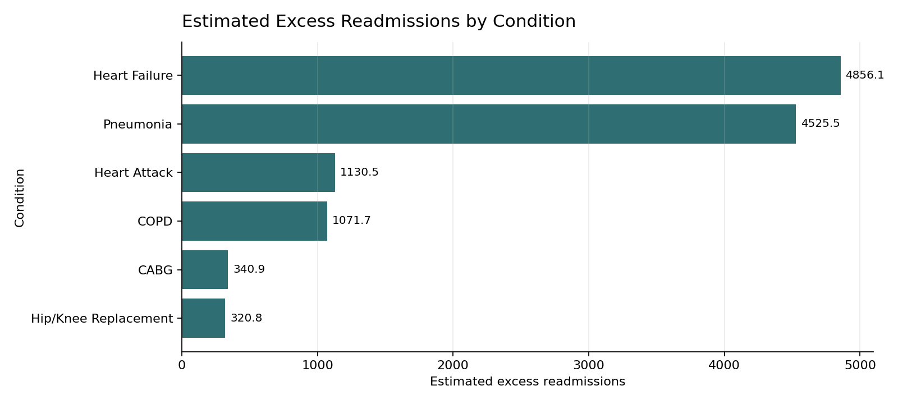
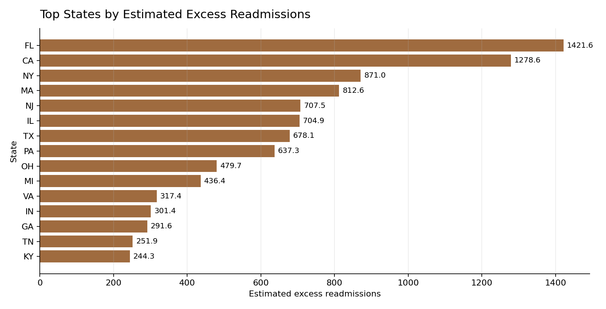
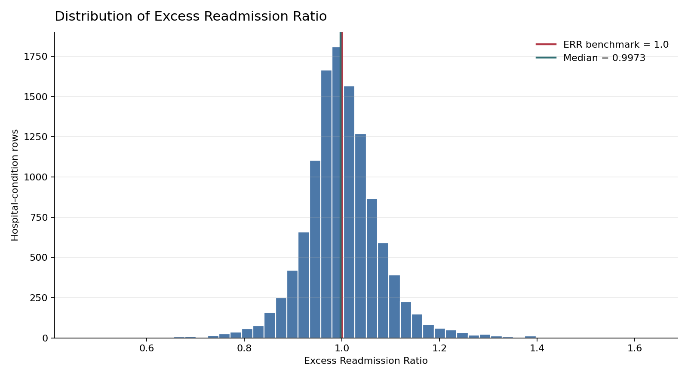
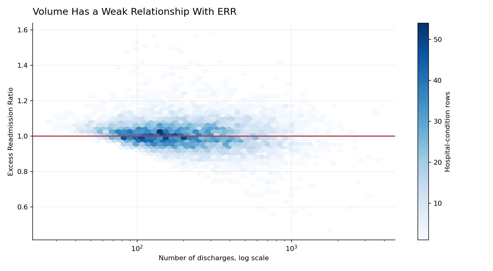

# CMS Hospital Readmissions Analytics & Prioritization Dashboard

[](https://github.com/DhruvShah-Dev/cms-hospital-readmissions-analysis/actions/workflows/quality.yml)


An end-to-end **healthcare data analytics portfolio project** examining CMS Hospital Readmissions Reduction Program (HRRP) performance with **Python, SQL, Pandas, Plotly, Streamlit, statistical analysis, and Excel**. The project identifies hospital-condition pairs with the largest measured readmission burden while preserving CMS suppression rules and risk-adjusted context.

> **Decision scope:** This dashboard prioritizes candidates for operational review. Estimated excess readmissions are not proven preventable events, causal effects, or Medicare penalty estimates.

## Contents

- [Project overview](#project-overview)
- [Key features](#key-features)
- [Visual analysis](#visual-analysis)
- [Dashboard pages](#dashboard-pages)
- [Current findings](#current-findings)
- [Project structure](#project-structure)
- [Run locally](#run-locally)
- [Metric definitions](#metric-definitions)
- [Repository topics](#repository-topics)

## Project Overview

Under the CMS Hospital Readmissions Reduction Program, hospitals with excess readmissions can face Medicare payment reductions. This project combines CMS HRRP results with Hospital General Information to answer:

> Which hospitals, conditions, and states have the largest measured 30-day readmission burden, and how does that ranking change after normalizing for discharge volume?

The repository contains a reproducible analytics workflow from raw-data profiling through stakeholder delivery:

`CMS source data` → `data quality and cleaning` → `feature engineering` → `SQL analysis` → `statistical testing` → `Streamlit dashboard and Excel workbook`

The analytic dataset contains **18,330 hospital-condition rows**, including **11,720 rows with numeric ERR** and **8,037 rows eligible for the estimated-excess calculation**.

## Key Features

| Capability | What it provides |
| --- | --- |
| **CMS healthcare data pipeline** | Profiles, cleans, validates, and joins HRRP results with hospital attributes while preserving suppressed values as missing. |
| **Defensible prioritization metric** | Estimates excess readmissions from the predicted-minus-expected rate gap and eligible discharge volume. |
| **Interactive Streamlit dashboard** | KPI cards, accessible hover details, filters, click-to-filter charts, reset controls, and CSV downloads. |
| **Geospatial analysis** | Interactive U.S. choropleth with both total burden and estimated excess per 1,000 discharges. |
| **Hospital benchmarking** | Condition-level ERR comparison, rating and ownership summaries, and hospital drilldown. |
| **Analyst and business Q&A** | Filter-aware answers with eligibility denominators, methodology caveats, and operational next steps. |
| **SQL analytics layer** | Reusable SQLite views and queries for national, condition, state, ownership, rating, hospital, and priority analysis. |
| **Statistical analysis** | Hospital-level comparisons, Spearman correlation, Kruskal-Wallis tests, and Benjamini-Hochberg FDR adjustment. |
| **Executive Excel workbook** | Summary KPIs, condition and state analysis, priority hospitals, conditional formatting, and model data. |
| **Automated quality controls** | Formula, missing-versus-zero, aggregation, and dataset-invariant tests run locally and in GitHub Actions. |

## Visual Analysis

The charts below are generated from the processed CMS data for the July 2021–June 2024 HRRP performance period.

### Estimated excess readmissions by condition



Heart failure and pneumonia contribute the largest measured total burden among hospital-condition rows with reportable discharge volume. This is a burden ranking, not a causal estimate of preventability.

### States with the largest total measured burden



State totals highlight where measured burden is concentrated. The dashboard also provides a per-1,000-discharge view for fairer comparisons across differently sized states.

### Distribution of the Excess Readmission Ratio



The ERR distribution is centered close to the CMS benchmark of 1.0, with meaningful tails on both sides. The median does not replace condition-, hospital-, or volume-specific review.

### Discharge volume and risk-adjusted performance



Discharge volume has a weak relationship with ERR. Volume is therefore more useful for sizing total burden than for explaining risk-adjusted performance.

## Dashboard Pages

- **Executive Overview**: headline KPIs, top conditions, top states, and initial priority hospitals
- **Condition Analysis**: estimated excess readmissions, readmission volume, and ERR distributions
- **Geography**: total burden versus estimated excess per 1,000 eligible discharges
- **Hospital Benchmarking**: rating and ownership analysis plus hospital-level drilldown
- **Analyst & Business Q&A**: concise answers to data analyst and stakeholder questions
- **Priority Detail**: filtered hospital-condition rows for follow-up and modeling

## Data Sources

- CMS Hospital Readmissions Reduction Program: https://data.cms.gov/provider-data/dataset/9n3s-kdb3
- CMS Hospital General Information: https://data.cms.gov/provider-data/dataset/xubh-q36u

Raw source files are stored unchanged in `data/raw/`.

## Current Findings

- 11,720 hospital-condition rows have numeric ERR values.
- 48.1% of numeric ERR rows are above the CMS benchmark of 1.0.
- Heart Failure and Pneumonia account for most of the estimated excess-readmission burden among rows with reportable volume.
- State totals identify where burden is largest; the normalized per-1,000 view produces a different ranking and is better for performance-intensity comparisons.
- One-star hospitals show higher average ERR than five-star hospitals, but this is descriptive and partly circular because readmission measures contribute to the CMS overall rating.
- Volume has a weak relationship with ERR, so it is more useful for sizing estimated burden than explaining risk-adjusted performance.

## Project Structure

```text
.
|-- .streamlit/
|   `-- config.toml
|-- .github/workflows/
|   `-- quality.yml
|-- data/
|   |-- raw/
|   `-- processed/
|-- images/
|-- notebooks/
|-- excel/
|-- reports/
|-- scripts/
|-- sql/
|-- tests/
|-- data_dictionary.md
|-- requirements.txt
`-- streamlit_app.py
```

## Run Locally

Clone the repository and install the pinned dependencies:

```powershell
git clone https://github.com/DhruvShah-Dev/cms-hospital-readmissions-analysis.git
cd cms-hospital-readmissions-analysis
pip install -r requirements.txt
```

Launch the interactive healthcare dashboard:

```powershell
python -m streamlit run streamlit_app.py
```

To rebuild every generated analysis artifact from the source files, run:

```powershell
python scripts/profile_cms_readmissions.py
python scripts/build_clean_dataset.py
python scripts/build_sql_layer.py
python scripts/run_eda_statistical_analysis.py
python scripts/build_excel_workbook.py
```

## Key Artifacts

- [`streamlit_app.py`](streamlit_app.py) — interactive CMS hospital readmissions dashboard
- [`excel/cms_readmissions_executive_workbook.xlsx`](excel/cms_readmissions_executive_workbook.xlsx) — executive Excel workbook
- [`data_dictionary.md`](data_dictionary.md) — field definitions and derived metric logic
- [`reports/01_data_profile.md`](reports/01_data_profile.md) — raw data profile
- [`reports/02_cleaning_report.md`](reports/02_cleaning_report.md) — cleaning and validation report
- [`reports/03_sql_analysis_report.md`](reports/03_sql_analysis_report.md) — SQL output summary
- [`reports/04_eda_statistical_analysis_report.md`](reports/04_eda_statistical_analysis_report.md) — EDA and statistical analysis
- [`sql/02_analysis_views.sql`](sql/02_analysis_views.sql) — reusable SQL views
- [`tests/test_metrics.py`](tests/test_metrics.py) — metric and dataset invariant tests

## Metric Definitions

**Excess Readmission Ratio (ERR)**  
CMS risk-adjusted performance metric. ERR above 1.0 indicates readmissions are higher than expected; ERR below 1.0 indicates better-than-expected performance.

**Readmission Gap**  
Predicted readmission rate minus expected readmission rate.

**Estimated Excess Readmissions**
Rate-gap-based prioritization proxy:

```text
(Predicted Readmission Rate - Expected Readmission Rate) * Number of Discharges / 100
```

Only positive estimates are used for burden ranking. Missing or suppressed inputs remain missing rather than being converted to zero. The result is not a causal estimate of preventable readmissions or financial penalty exposure.

**Normalized Geographic Intensity**

```text
Estimated Excess Readmissions / Eligible Discharges * 1,000
```

Use totals to locate aggregate burden and the normalized measure to compare intensity across differently sized states.

## Interpretation Limits

- The measurement period is July 1, 2021 through June 30, 2024; this is not live performance.
- CMS suppresses many low-volume rows, so the eligible subset is not a random sample.
- Overall hospital rating is not an independent predictor of readmission performance because readmission measures contribute to the rating.
- State and ownership comparisons are descriptive and do not adjust for hospital or patient mix.
- Local clinical and care-transition data are required before selecting an intervention.

## Tech Stack

- Python
- Pandas
- SQLite
- SQL
- SciPy
- Plotly
- Streamlit
- CMS healthcare data

## Repository Topics

Recommended GitHub topics for discoverability:

`cms` `cms-data` `healthcare-analytics` `healthcare-data` `hospital-readmissions` `hrrp` `medicare` `risk-adjustment` `public-health` `streamlit-dashboard` `data-visualization` `python` `sql` `pandas` `plotly` `scipy` `sqlite` `excel-dashboard` `statistical-analysis` `data-analytics-portfolio`

Search terms represented naturally throughout this project include **CMS hospital readmissions analysis**, **HRRP analytics**, **Medicare readmission dashboard**, **healthcare data science**, **hospital performance benchmarking**, **30-day readmission analysis**, **risk-adjusted healthcare metrics**, and **Streamlit healthcare dashboard**.

## Quality Controls

Run `pytest` to validate metric formulas, missing-versus-zero behavior, aggregation, and key dataset invariants. GitHub Actions runs the same checks for proposed changes.

```powershell
python -m pytest -q
```

## Intended Audience

- Healthcare data analysts and business intelligence professionals
- Hospital quality-improvement and care-transition teams
- Data analytics portfolio reviewers and hiring managers
- Python, SQL, Streamlit, and healthcare-data learners

## Responsible Use

This project uses public CMS data for analytical and educational purposes. Rankings should be treated as screening signals for further investigation—not as clinical judgments, causal findings, or estimates of preventable events or financial penalties.
