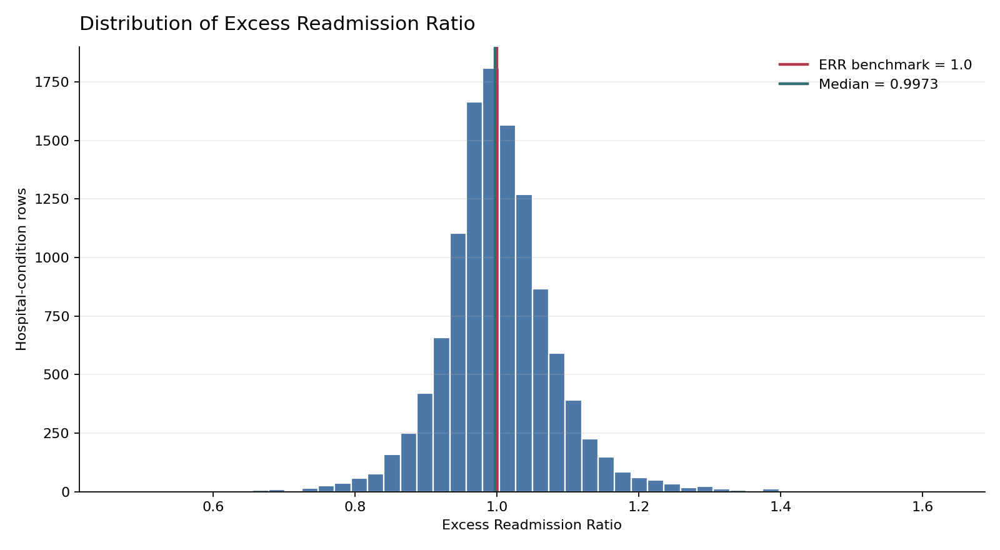
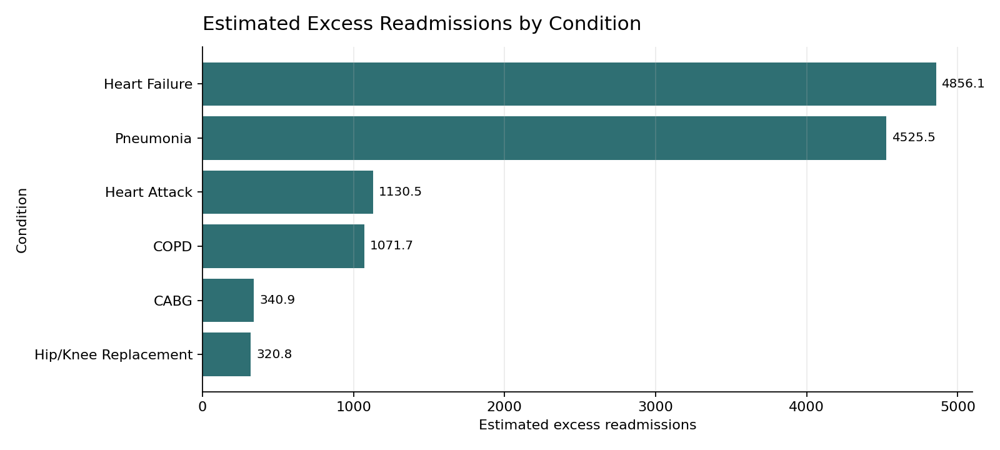
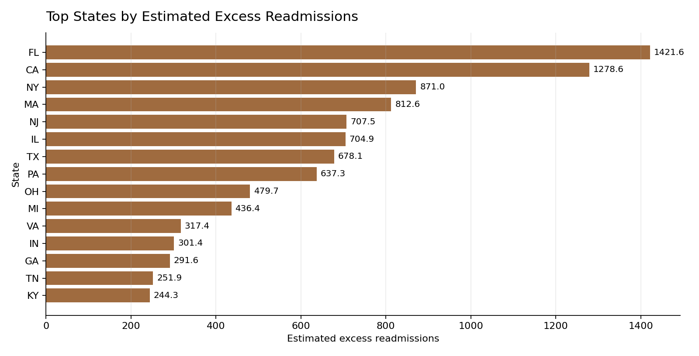
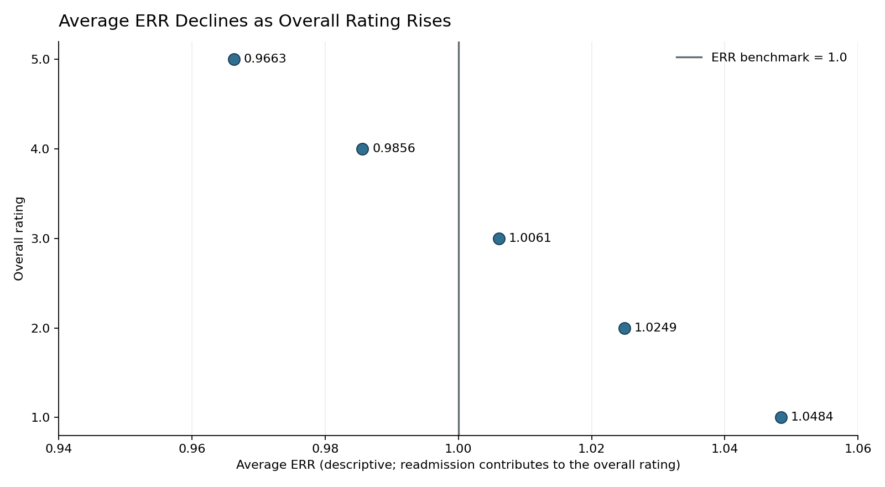
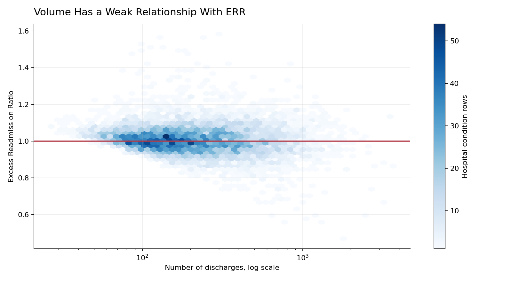

# EDA And Statistical Analysis: CMS Hospital Readmissions

## Executive Summary

- **Estimated excess readmissions are concentrated by condition.** Heart Failure has the largest rate-gap-based estimate (4,856.1); the estimate is a prioritization proxy, not a count of preventable events.
- **Total and normalized geography answer different questions.** FL has the highest total estimated excess burden (1,421.6), while normalized results identify performance intensity independent of state size.
- **Overall rating and ERR are descriptively aligned.** One-star hospitals average ERR 1.0484, while five-star hospitals average ERR 0.9663; this comparison is partly circular because readmission measures contribute to the CMS overall rating.
- **Volume has only a weak monotonic relationship with ERR.** Spearman rho is -0.1606, so volume is more useful for sizing estimated burden than explaining risk-adjusted performance.

## Context And Method

The analysis uses the cleaned CMS HRRP analytic table at hospital-condition grain. ERR is interpreted as the risk-adjusted readmission performance measure, where values above 1.0 indicate excess readmissions versus expected performance for similar patients.

Hospital-characteristic comparisons aggregate ERR to one row per hospital before Kruskal-Wallis testing so repeated condition rows are not treated as independent hospitals. Condition comparisons remain hospital-condition analyses and are labeled accordingly. Test p-values include a Benjamini-Hochberg false-discovery-rate adjustment. Volume correlation uses Spearman rank correlation. These tests indicate association, not causality.

## National Picture

| metric | value |
| --- | --- |
| Hospital-condition rows with numeric ERR | 11,720 |
| Hospitals with at least one numeric ERR | 2,833 |
| Average ERR | 1.0018 |
| Median ERR | 0.9973 |
| Rows above ERR benchmark | 48.1% |
| Rows at or above ERR 1.05 | 21.8% |
| Reported numeric readmissions | 391,809 |
| Positive estimated excess readmissions | 12,245.5 |

The national ERR distribution is centered near 1.0, as expected for a risk-adjusted benchmark. Prioritization therefore combines performance with eligible discharge volume while keeping suppressed rows visible as unscored rather than zero.

## Conditions Driving Estimated Excess Readmissions

| condition | rows | hospitals | avg_err | median_err | pct_err_gt_1 | readmissions | discharges | estimated_excess | eligible_rows |
| --- | --- | --- | --- | --- | --- | --- | --- | --- | --- |
| Heart Failure | 2621 | 2621 | 1.0014 | 0.9983 | 0.4891 | 169065.0 | 858817.0 | 4856.1443 | 2316 |
| Pneumonia | 2715 | 2715 | 1.0015 | 0.9955 | 0.4681 | 131428.0 | 811908.0 | 4525.4682 | 2320 |
| Heart Attack | 1736 | 1736 | 1.0018 | 0.9994 | 0.4965 | 36231.0 | 268260.0 | 1130.4553 | 1240 |
| COPD | 2323 | 2323 | 1.0011 | 0.9969 | 0.4722 | 42934.0 | 224493.0 | 1071.726 | 1545 |
| CABG | 878 | 878 | 1.0018 | 1.0 | 0.4989 | 7153.0 | 65148.0 | 340.9224 | 363 |
| Hip/Knee Replacement | 1447 | 1447 | 1.004 | 0.9916 | 0.4789 | 4998.0 | 107291.0 | 320.7734 | 253 |

Heart Failure and Pneumonia dominate the estimated excess-readmission ranking because they combine positive rate gaps with high eligible discharge volume. CABG has similar average ERR but materially lower volume.

## Geography

| state | hospitals | avg_err | pct_err_gt_1 | readmissions | estimated_excess | eligible_rows | discharges | excess_per_1000 |
| --- | --- | --- | --- | --- | --- | --- | --- | --- |
| FL | 164 | 1.0229 | 0.5746 | 35222.0 | 1421.5522 | 598 | 197109.0 | 7.212 |
| CA | 253 | 1.0101 | 0.552 | 33249.0 | 1278.6086 | 699 | 190141.0 | 6.7245 |
| NY | 124 | 1.0019 | 0.5269 | 23521.0 | 871.0233 | 391 | 140718.0 | 6.1898 |
| MA | 52 | 1.0344 | 0.625 | 15668.0 | 812.592 | 200 | 92376.0 | 8.7966 |
| NJ | 61 | 1.0277 | 0.6544 | 15078.0 | 707.51 | 222 | 83063.0 | 8.5178 |
| IL | 109 | 1.0194 | 0.5784 | 20558.0 | 704.8903 | 369 | 116336.0 | 6.0591 |
| TX | 244 | 1.0043 | 0.4955 | 26324.0 | 678.1429 | 585 | 157205.0 | 4.3137 |
| PA | 126 | 1.0069 | 0.5101 | 18208.0 | 637.3452 | 374 | 107736.0 | 5.9158 |
| OH | 111 | 1.0085 | 0.5198 | 15899.0 | 479.7003 | 358 | 90776.0 | 5.2844 |
| MI | 83 | 1.0054 | 0.4807 | 12337.0 | 436.4377 | 246 | 67794.0 | 6.4377 |
| VA | 69 | 0.9943 | 0.4437 | 12509.0 | 317.3977 | 233 | 76683.0 | 4.1391 |
| IN | 76 | 0.9976 | 0.4517 | 10180.0 | 301.3729 | 219 | 59735.0 | 5.0452 |
| GA | 88 | 1.0114 | 0.5578 | 10771.0 | 291.6093 | 244 | 61123.0 | 4.7709 |
| TN | 71 | 1.0054 | 0.5088 | 9281.0 | 251.883 | 207 | 56582.0 | 4.4516 |
| KY | 59 | 1.0101 | 0.5419 | 7223.0 | 244.2806 | 162 | 40652.0 | 6.0091 |

Total estimated burden identifies where the largest number of excess cases may be concentrated; the normalized per-1,000 measure identifies performance intensity. Large-state totals must not be described as uniformly worse performance.

## Hospital Characteristics

| rating_label | overall_rating_group | hospitals | avg_err | median_err | pct_err_gt_1 | estimated_excess |
| --- | --- | --- | --- | --- | --- | --- |
| 1.0 | Low Rating | 169 | 1.0484 | 1.035 | 0.7255 | 1193.5919 |
| 2.0 | Low Rating | 567 | 1.0249 | 1.0177 | 0.6106 | 3630.8782 |
| 3.0 | Middle Rating | 840 | 1.0061 | 1.0 | 0.4993 | 3967.5613 |
| 4.0 | Middle Rating | 758 | 0.9856 | 0.9847 | 0.3883 | 2533.6878 |
| 5.0 | High Rating | 287 | 0.9663 | 0.9687 | 0.3069 | 817.6902 |
| Missing Rating |  | 212 | 0.9838 | 0.9919 | 0.4261 | 102.0802 |

| hospital_ownership | hospitals | avg_err | median_err | pct_err_gt_1 | estimated_excess |
| --- | --- | --- | --- | --- | --- |
| Missing Hospital Attributes | 15 | 1.0303 | 1.0149 | 0.6154 | 49.3213 |
| Proprietary | 544 | 1.017 | 1.0081 | 0.5495 | 2162.7981 |
| Government - Federal | 13 | 1.0032 | 1.0177 | 0.5897 | 44.1749 |
| Government - Local | 129 | 1.0026 | 1.0045 | 0.5278 | 279.5852 |
| Government - State | 37 | 1.0008 | 1.0055 | 0.521 | 158.5341 |
| Government - Hospital District or Authority | 206 | 0.9998 | 0.9965 | 0.4746 | 597.6775 |
| Voluntary non-profit - Private | 1404 | 0.999 | 0.9947 | 0.4647 | 7237.8451 |
| Voluntary non-profit - Other | 229 | 0.9987 | 0.9952 | 0.4605 | 808.5669 |
| Voluntary non-profit - Church | 195 | 0.9942 | 0.9884 | 0.4375 | 868.3027 |
| Tribal | 5 | 0.9756 | 0.9756 | 0.3 | 0.0 |
| Physician | 56 | 0.9535 | 0.9788 | 0.3789 | 38.6839 |

Lower-rated hospitals have higher average ERR, but this is a descriptive alignment rather than an independent explanatory result because readmission measures contribute to the overall CMS rating. Ownership comparisons remain vulnerable to differences in category size, hospital mix, and case volume.

## Volume Relationship

Spearman correlation between discharges and ERR is -0.1606 with p-value <0.001 across 8,037 eligible rows. The relationship is statistically significant but weak, so volume should size estimated burden rather than imply worse performance.

## Statistical Tests

| grouping | groups_tested | n | h_statistic | p_value | epsilon_squared | interpretation | p_value_fdr |
| --- | --- | --- | --- | --- | --- | --- | --- |
| condition | 6 | 11720 | 6.9311 | 0.2258 | 0.0002 | No statistically significant difference detected | 0.2258 |
| state | 44 | 2783 | 323.8185 | <0.001 | 0.1025 | Statistically different ERR distributions | <0.001 |
| hospital_ownership | 9 | 2813 | 77.3461 | <0.001 | 0.0247 | Statistically different ERR distributions | <0.001 |
| hospital_overall_rating | 5 | 2621 | 520.6753 | <0.001 | 0.1975 | Statistically different ERR distributions | <0.001 |
| overall_rating_group | 3 | 2621 | 424.378 | <0.001 | 0.1613 | Statistically different ERR distributions | <0.001 |

Hospital-level tests reduce repeated-measures inflation but remain descriptive and unadjusted for hospital mix. Effect sizes are reported because statistical significance is not the same as operational importance.

## Hospital-Condition Review Priorities

| facility_id | facility_name | state | condition | excess_readmission_ratio | number_of_discharges | positive_estimated_excess_readmissions | hospital_overall_rating | hospital_ownership |
| --- | --- | --- | --- | --- | --- | --- | --- | --- |
| 100007 | ADVENTHEALTH ORLANDO | FL | Heart Failure | 1.1447 | 3487.0 | 105.8 | 3.0 | Voluntary non-profit - Private |
| 100007 | ADVENTHEALTH ORLANDO | FL | Pneumonia | 1.1409 | 3588.0 | 85.6 | 3.0 | Voluntary non-profit - Private |
| 050030 | OROVILLE HOSPITAL | CA | Pneumonia | 1.4255 | 833.0 | 60.8 | 1.0 | Voluntary non-profit - Private |
| 330194 | MAIMONIDES MEDICAL CENTER | NY | Pneumonia | 1.3011 | 975.0 | 53.5 | 2.0 | Voluntary non-profit - Private |
| 220100 | SOUTH SHORE HOSPITAL | MA | Pneumonia | 1.1766 | 1883.0 | 52.1 | 2.0 | Voluntary non-profit - Private |
| 310022 | WEST JERSEY HOSPITAL | NJ | Heart Failure | 1.1999 | 1175.0 | 45.6 | 3.0 | Voluntary non-profit - Private |
| 490022 | MARY WASHINGTON HOSPITAL | VA | Pneumonia | 1.238 | 1178.0 | 45.4 | 3.0 | Voluntary non-profit - Private |
| 310041 | COMMUNITY MEDICAL CENTER | NJ | Heart Failure | 1.1729 | 1272.0 | 42.8 | 1.0 | Voluntary non-profit - Private |
| 330198 | MOUNT SINAI SOUTH NASSAU | NY | Pneumonia | 1.1933 | 1236.0 | 39.8 | 3.0 | Voluntary non-profit - Private |
| 230269 | BEAUMONT HOSPITAL, TROY | MI | Heart Failure | 1.1127 | 1649.0 | 37.4 | 4.0 | Voluntary non-profit - Private |
| 390115 | JEFFERSON HEALTH- NORTHEAST | PA | Heart Failure | 1.2197 | 839.0 | 36.6 | 2.0 | Voluntary non-profit - Private |
| 070025 | HARTFORD HOSPITAL | CT | Heart Failure | 1.1395 | 1305.0 | 36.4 | 4.0 | Voluntary non-profit - Private |
| 310041 | COMMUNITY MEDICAL CENTER | NJ | Pneumonia | 1.1412 | 1483.0 | 34.4 | 1.0 | Voluntary non-profit - Private |
| 050239 | GLENDALE ADVENTIST MEDICAL CENTER | CA | Pneumonia | 1.1485 | 1336.0 | 34.3 | 4.0 | Voluntary non-profit - Private |
| 310086 | JEFFERSON STRATFORD HOSPITAL | NJ | Heart Failure | 1.1389 | 1256.0 | 34.3 | 2.0 | Voluntary non-profit - Private |
| 330393 | SUNY/STONY BROOK UNIVERSITY HOSPITAL | NY | Heart Failure | 1.1051 | 1566.0 | 34.3 | 5.0 | Government - State |
| 210001 | MERITUS MEDICAL CENTER | MD | Pneumonia | 1.2406 | 896.0 | 33.8 | 3.0 | Voluntary non-profit - Private |
| 390133 | LEHIGH VALLEY HOSPITAL | PA | Pneumonia | 1.154 | 1329.0 | 31.9 | 4.0 | Voluntary non-profit - Private |
| 100075 | ST JOSEPHS HOSPITAL | FL | Heart Failure | 1.1111 | 1386.0 | 31.5 | 4.0 | Voluntary non-profit - Church |
| 050093 | SAINT AGNES MEDICAL CENTER | CA | Heart Failure | 1.1768 | 916.0 | 31.3 | 2.0 | Voluntary non-profit - Church |

These hospital-condition rows are starting points for review because they combine positive rate gaps with enough eligible volume to matter. Local service-line context, discharge planning, payer mix, and care-transition data are required before action plans or preventability claims.

## Caveats

- CMS suppresses many low-volume rows, so estimated excess readmissions apply only where predicted rate, expected rate, and discharges are numeric.
- Estimated excess readmissions are a rate-gap proxy, not a causal estimate of preventable cases or financial penalty exposure.
- State totals reflect both performance and population size; use the normalized per-1,000 measure for intensity.
- Overall star-rating comparisons are partly circular because readmission measures contribute to the rating.
- Statistical tests are association tests and do not prove that rating, ownership, geography, or condition causes readmission differences.
- The HRRP measurement period is July 1, 2021 through June 30, 2024; results should not be described as current live performance.

## Recommended Next Step

Review high estimated-excess hospital-condition rows, then validate the result with local care-transition and service-line data before selecting interventions.
